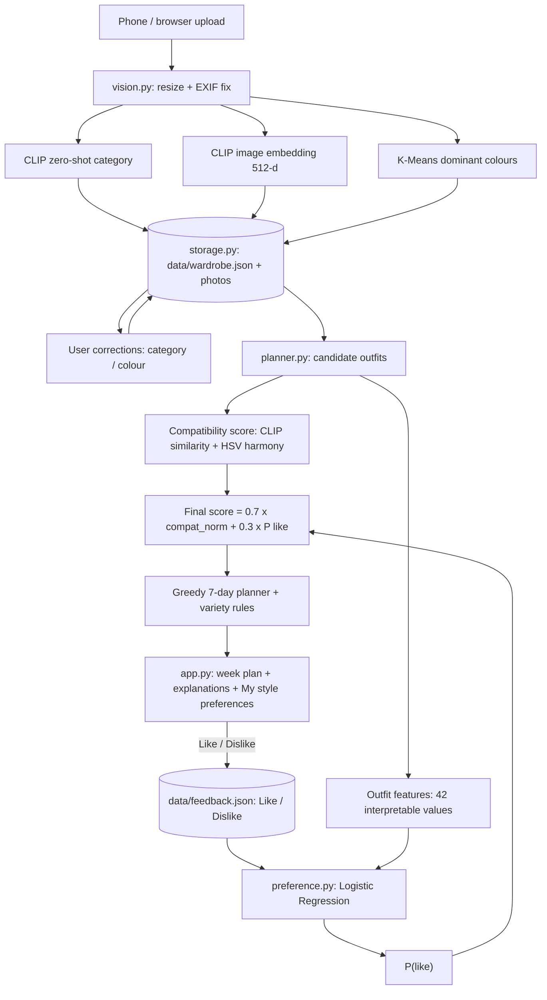

# La Catrina: project context for the presentation and report

This document is the single source of facts about La Catrina for writing the presentation (PPT) and the coursework report. Every number below was measured in this project. Where a result comes from simulated or synthetic data, it is labelled **illustrative**.

---

## 1. One-paragraph summary

La Catrina is an AI-powered wardrobe and weekly outfit planner. It runs locally on a CPU and works in a phone browser. The user photographs their clothes:

- **CLIP** (zero-shot) identifies each garment's category.
- **K-Means** extracts its three dominant colours.
- The user can correct either.

The app then plans **seven daily outfits**. It ranks every possible outfit with a **compatibility score**: CLIP visual similarity plus HSV colour-harmony rules. It also applies weekly variety constraints. The user rates outfits with **Like / Dislike**. A **scikit-learn Logistic Regression** model learns their taste from interpretable outfit features and is blended into the ranking (70% compatibility / 30% preference). Every personalised ranking comes with an explanation grounded in the model's actual weights.

It is a **hybrid recommender**: visual and colour compatibility plus feedback-based personalisation. It is built to be explainable, lightweight and honest about its limits.

---

## 2. Problem statement and motivation

- **Choosing outfits takes time.** People often re-wear the same few combinations and forget what they own.
- **Existing recommenders are opaque.** Commercial fashion recommenders are opaque, cloud-based and trained on other people's data. They don't learn *your* taste from *your* wardrobe.
- **The coursework goal.** Build a functional, explainable ML system in which every algorithm has a clear purpose and can be justified. It should not be a black-box commercial clone.

## 3. Objectives

1. Digitise a wardrobe from phone photos with **automatic category and colour detection**.
2. Let the user **correct** model mistakes, and keep those corrections.
3. Generate a **varied 7-day outfit plan** with sensible compatibility rules.
4. **Learn user preferences** from Like/Dislike feedback and use them to re-rank recommendations.
5. **Explain** every recommendation in plain language, grounded in model features.
6. **Evaluate** each ML component honestly (classification accuracy and preference-model metrics).
7. Run **locally on CPU**, with **no paid APIs, no database server and no GPU**.

---

## 4. Technology stack

| Layer | Technology | Why it was chosen |
|---|---|---|
| Language | Python 3.13 | Standard for ML; one language end to end |
| UI | Streamlit 1.67 | Fast to build, responsive in a phone browser |
| Vision model | OpenAI CLIP `openai/clip-vit-base-patch32` (Hugging Face `transformers`, PyTorch CPU) | Zero-shot classification with no training data; small enough for CPU |
| Clustering | scikit-learn `KMeans` | Dominant colour extraction |
| Preference model | scikit-learn `Pipeline(StandardScaler, LogisticRegression)` | Interpretable, works with small data, well understood |
| Evaluation | scikit-learn metrics, `StratifiedKFold`, `cross_val_predict`; SciPy `spearmanr` | Standard, leakage-free evaluation |
| Data | NumPy, Pandas, Pillow | Arrays, CSV labels, image handling |
| Storage | Local JSON files and JPEG photos | No database server needed; easy to inspect |

The code is about 2,000 lines of Python across 9 files.

---

## 5. System architecture



### Files and responsibilities

| File | Responsibility |
|---|---|
| `app.py` | Streamlit UI with three tabs (Add, Wardrobe, Week plan), the My style preferences panel, and the vintage film CSS |
| `vision.py` | CLIP loading (cached once), zero-shot classification, image embeddings, K-Means colours |
| `colours.py` | 25-colour palette, RGB→name (CIELAB nearest), HSV harmony rules |
| `planner.py` | Outfit features, compatibility and final scoring, explanations, greedy weekly planner |
| `preference.py` | Logistic Regression preference model, readiness rules, evaluation |
| `storage.py` | JSON and photo persistence; one rating per outfit |
| `evaluate.py` | Category and colour accuracy against `labels.csv`; `--preferences` evaluates the preference model |
| `evaluate_public.py` | Downloads a reproducible sample of a public fashion dataset and evaluates category (with a prompt ablation) and colour accuracy |
| `test_personalisation.py` | 11 automated tests |
| `.streamlit/config.toml` | Vintage analog theme |

### Data files (all local)

- `data/wardrobe/`: resized JPEG photos (max 800 px).
- `data/wardrobe.json`: one record per item:
  - id
  - filename
  - predicted category and the user's category
  - class probabilities
  - 3 colours with shares
  - predicted main colour and the user's main colour
  - 512-d CLIP embedding
  - a "corrected" flag
- `data/feedback.json`: `[{"items": [ids], "label": 1|0, "time": ...}]`, one record per outfit.
- `labels.csv`: the user's ground truth for evaluation (`filename,category,main_colour`).

---

## 6. Algorithms in detail

### 6.1 Clothing category: CLIP zero-shot classification
- **The model.** CLIP maps images and text into one shared 512-d embedding space.
- **Prompts.** Each of the 9 categories (shirt, T-shirt, jeans, trousers, skirt, dress, jacket, footwear, accessory) is described by 2 text prompts, for example "a photo of jeans" and "a photo of denim jeans". The T-shirt class has 4, including "tank top" and "camisole".
- **Classification:**
  1. The prompt embeddings for each class are averaged into one class vector.
  2. The image is resized (max 448 px) and embedded.
  3. `softmax(100 × cosine similarity)` over the 9 class vectors gives the probabilities.
  4. The highest one is the prediction.
- **No training.** No training images are needed, which is the point of zero-shot learning.
- **Speed.** About 0.25 s per image on CPU. The model loads once and is cached (`st.cache_resource`).

### 6.2 Dominant colours: K-Means with simple background removal
1. Shrink the image to 128 px.
2. Estimate the background: K-Means (k = 2) on the 3-px border pixels gives the two background colours (for example bed + floor).
3. Take the centre 70% of the image and drop pixels within RGB distance 40 of a background colour. If less than 10% remain (for example a white shirt on a white sheet), keep all centre pixels.
4. Run K-Means (k = 5, `random_state=0`) on the remaining pixels.
5. Name each cluster with the nearest of 25 palette colours, measured in **CIELAB** (a perceptual colour space). Clusters with the same name (the shadow and highlight of one garment) are merged.
6. Return the **3 largest named colours** with their pixel shares. The largest is the "main colour".

Two of these steps came from testing:
- **Background removal:** the white background was being reported as the main colour.
- **Same-name merging:** shading split an olive dress into "brown" plus "olive", and "brown" came out on top.

### 6.3 Colour harmony (HSV rules), per pair of pieces
| Pair type | Rule | Score |
|---|---|---|
| Neutral | Either colour is neutral (black, grey, white, beige, navy, denim…, or saturation < 0.2, or value < 0.2) | +1.0 |
| Analogous | Hue difference ≤ 30° | +0.8 |
| Complementary | Hue difference ≥ 150° | +0.7 |
| Clash | Both saturation > 0.5 and none of the above | −1.0 |
| Mixed | Anything else | 0.0 |

### 6.4 Compatibility score (baseline, not trained)
```
compatibility = 0.5 × mean pairwise CLIP image cosine similarity
              + 0.5 × (mean pairwise harmony + 1) / 2
```
This is a **baseline**. CLIP similarity measures *visual* similarity, not a learned "these go together". A trained compatibility model (for example on the Polyvore outfits dataset) is future work.

### 6.5 Outfit generation and weekly planner
- **Outfit structure.** An outfit is (top + bottom) **or** a dress, plus **required** footwear. A jacket and an accessory are **optional** layers.
- **Candidate generation.**
  1. Build every core + footwear combination and keep the best 300.
  2. Expand each with the best 3 jackets and best 3 accessories, plus none of each.
- **Greedy 7-day selection.** Each day picks the candidate with the highest *effective* score: `final score − 0.12 × average reuse of its pieces − 0.2 × max overlap with earlier days`.
- **Hard rules:**
  - no identical outfit twice;
  - no piece used more than 3 times;
  - outfits the user disliked are skipped.
- **Relaxation.** If the wardrobe is too small, the rules are relaxed in stages and the app **says so on screen**:
  1. the 3-uses limit is lifted;
  2. then repeats are allowed.
- **Missing parts.** If there is no top, bottom or footwear, the app says exactly what to add.

### 6.6 Personalisation: Logistic Regression preference model
**Features.** Each outfit becomes 42 named, interpretable values:

| Group | Count | Meaning |
|---|---|---|
| `cat:<category>` | 9 | 1 if that garment type is in the outfit (covers jacket / accessory presence) |
| `colour:<name>` | 25 | 1 if a piece's main colour is that palette colour |
| `harmony:<kind>` | 5 | Share of colour pairs that are neutral / analogous / complementary / clash / mixed |
| `clip_similarity` | 1 | Mean CLIP similarity of the pieces |
| `neutral_share` | 1 | Share of neutral pieces |
| `n_colours` | 1 | Number of distinct main colours |

Features are recomputed from the current wardrobe every time the model trains, so a correction to a colour or category also corrects past ratings.

**Model.** `make_pipeline(StandardScaler(), LogisticRegression(C=0.5, class_weight="balanced", max_iter=1000))`

- `P(like) = sigmoid(b + Σ wᵢ · zᵢ)`, where `zᵢ` is the standardised feature value and `wᵢ` its learned weight.
- **StandardScaler:** puts binary and continuous features on one scale, so the weights are comparable and can be explained.
- **C = 0.5:** stronger L2 regularisation, so a handful of ratings doesn't produce over-confident predictions.
- **`class_weight="balanced"`:** a user who mostly clicks Like doesn't get a model that predicts "like" for everything.
- **Determinism:** retrained from scratch on all ratings whenever a rating changes. The lbfgs solver is deterministic and the data is tiny, so retraining is instant.

**Readiness (insufficient-data handling).** The model is trained only when there are **≥ 6 ratings, with ≥ 2 likes and ≥ 2 dislikes**. Until then, and whenever every rating has the same label, the app falls back to the original compatibility ranking and tells the user how many more ratings are needed.

### 6.7 Final recommendation score
```
compat_norm = compatibility min-max scaled to 0..1 over all candidate outfits in this wardrobe
final       = 0.7 × compat_norm + 0.3 × P(like)      if the model is ready
final       = compatibility                          otherwise (identical to the original system)
```
- **Why rescale?** Raw compatibility lives in a narrow band (most outfits score ≈0.85–0.95), while P(like) spans 0–1. Without rescaling, a 0.3 preference weight almost completely replaced the compatibility ranking (Spearman ρ = 0.06). After rescaling, ρ = 0.89.
- **Compatibility guard.** For outfits in the bottom 25% of compatibility, P(like) is capped at 0.5. Likes can push a poor match **down** but never pull it **up**, so personalisation cannot override basic compatibility.
- **The weight is configurable.** `PREF_WEIGHT = 0.3` in code, adjustable 0–0.5 with a slider in the app. 0 means pure compatibility; higher means ratings matter more.

### 6.8 Explanations (grounded in the model)
Each outfit gets two one-line explanations.

1. **Compatibility line (templated).** For example: "olive T-shirt + light grey trousers + brown footwear + charcoal jacket: neutral base with an olive accent; strong CLIP style match (0.78)."
2. **Personalisation line.** For example: "Personalised: 92% predicted like (up 5 places vs. compatibility-only ranking); main factor: you tend to like olive pieces."
   - **How the main factor is chosen.** It is the feature with the largest **log-odds contribution** (weight × standardised value) *in the same direction as the prediction*.
   - **When a factor is cited.** Only if it moves the log-odds by ≥ 0.3, and only if P(like) is at least 0.1 away from 0.5. Otherwise the line says the ratings "don't strongly favour or penalise this outfit".
   - **Before the model is ready.** The line says "Ranked on compatibility only (personalisation not active yet)". The app never makes an unsupported claim about the user's taste.

### 6.9 Feedback handling
- **One rating per outfit.** An outfit's identity is its sorted item ids, so the same set of pieces in any order is one outfit.
- **Changing a rating.** Tapping the other button changes the rating; tapping the highlighted button again clears it. There are never duplicate records.
- **Older files.** Feedback files from the first version (which could contain duplicates) are de-duplicated on load, keeping the latest rating.
- **After each rating:**
  1. the rating is saved immediately;
  2. the model retrains;
  3. each outfit card shows its updated score and rank;
  4. **Re-plan** rebuilds the week and shows a before / after table.

---

## 7. User interface

- **Three tabs:**
  - **Add:** multi-photo upload, which opens the camera on phones. An optional in-page camera needs HTTPS.
  - **Wardrobe:** review items and correct category or colour.
  - **Week plan:** the 7 outfits, ratings and personalisation.
- **My style preferences** panel:
  - liked and disliked counts;
  - model status (Ready / Not yet) and how many more ratings it needs;
  - learned likes and avoids (only once the model is ready);
  - the personalisation weight slider;
  - the evaluation panel.
- **Design.** A vintage analog / retro film theme:
  - cream background, serif type, sepia headings, faded-teal buttons;
  - tan and dusty-rose badges;
  - a film-grain overlay;
  - photos shown as tilted polaroids with a light leak;
  - a VHS-jitter and shake effect on hover;
  - fade-in transitions.
- **Accessibility:**
  - all text meets WCAG AA contrast, even under the grain overlay (checked numerically, for example body text 7.5:1);
  - alt text on every photo;
  - text labels on the Like / Dislike buttons;
  - visible focus outlines;
  - all animation off under `prefers-reduced-motion`.
- **Responsive.** Tested at phone size (375 px wide). Buttons go full-width and tables scroll.

---

## 8. Evaluation and results

> Only these numbers are real measurements. Results on simulated or synthetic data are marked **illustrative**: they show the pipeline works, not real-world performance.

### 8.1 Category classification (CLIP zero-shot), on the user's 10 real labelled photos
| Stage | Category accuracy | Notes |
|---|---|---|
| First run, original labels | 9/10 | Misclassified a rust camisole top as a dress |
| After relabelling the olive "top3" from dress to T-shirt | 8/10 | Both sleeveless tops were predicted as dress |
| After adding "tank top" and "camisole" prompts | **10/10** | ⚠️ Optimistic: the prompts were tuned after seeing these same photos. A fair estimate needs new photos |

The synthetic garment drawings (illustrative) scored **9/12**, both before and after the prompt change, so the new prompts didn't cause any regression.

The full per-class precision, recall and F1, plus the confusion matrix, are printed by `python evaluate.py`.

### 8.1b Category classification on a PUBLIC dataset (the main, credible result)
- **Dataset:** "Fashion Product Images (Small)", the Hugging Face mirror `ashraq/fashion-product-images-small`.
  - 44,072 e-commerce photos, 60 × 80 px, labelled with product type and colour.
  - The mirror lists no licence; it is a copy of a dataset widely used for education and research.
- **Sample:** 900 images, a random sample with seed 0, **100 per category**. Dataset types were mapped to our 9 categories:
  - `Tshirts`/`Tops` → T-shirt
  - `Casual Shoes`, `Heels`, `Sandals`… → footwear
  - `Handbags`, `Belts`, `Caps`, `Watches`… → accessory
  - Types with no clear match (kurtas, sarees, shorts, innerwear, cosmetics) were excluded.
- **No training.** CLIP is used exactly as in the app. Run with `python evaluate_public.py --download --per-class 100` then `--run`. The full report is in `eval_results/public_eval.md`.

| Prompt design (ablation, same 900 images) | Accuracy | 95% CI (Wilson) |
|---|---|---|
| Generic: one prompt "a photo of a {category}" | 88.4% (796/900) | 86.2–90.4% |
| Our ensemble before "tank top / camisole" | 87.6% (788/900) | 85.2–89.6% |
| **Our ensemble, current (used by the app)** | **87.2% (785/900)** | **84.9–89.2%** |

| Class | Precision | Recall | F1 |
|---|---|---|---|
| shirt | 0.81 | 1.00 | 0.89 |
| T-shirt | 0.91 | 0.83 | 0.87 |
| jeans | 0.90 | **0.63** | 0.74 |
| trousers | 0.71 | 0.98 | 0.82 |
| skirt | 0.93 | 0.71 | 0.81 |
| dress | 0.83 | 0.90 | 0.87 |
| jacket | 1.00 | 0.82 | 0.90 |
| footwear | 1.00 | 0.99 | 0.99 |
| accessory | 0.88 | 0.99 | 0.93 |

**What it shows:**
- **Zero-shot CLIP classifies about 87% of unseen products correctly, with no training at all.**
- **Main confusions:**
  - jeans → trousers (35 of 100);
  - T-shirt → shirt (14);
  - jacket → shirt (9);
  - skirt → dress (11).

  All of these are visually similar garment pairs, which is especially hard at 60 × 80 px.
- **The prompt ablation is an honest negative result.** The three prompt designs are statistically indistinguishable (their confidence intervals overlap almost entirely). The "tank top / camisole" prompts that gave 10/10 on our own 10 photos did **not** improve accuracy on public data. This confirms the earlier warning that tuning on 10 photos was optimistic.
- **This 87.2% replaces the 10/10 as the headline category result.** The 10/10 was measured on only 10 photos that had also guided the prompt design.

### 8.2 Dominant colour (exact palette-name match), on the 10 real photos
| Stage | Main-colour match | Notes |
|---|---|---|
| Original labels | 1/9 | Several labels used names not in the palette (green vs olive, red vs maroon) and "gold" isn't a palette colour |
| After correcting the labels | **4/10** | The remaining misses are real detector errors: light-wash denim and white shoes in shade read as grey, small jewellery on a grey table, two-tone shoes |

**Lesson:** an exact-name metric is strict. Lighting and background are the main error sources, which is why manual colour correction is part of the design.

### 8.2b Dominant colour on the public dataset (869 images whose colour label has an exact palette equivalent)
| Metric | Result | 95% CI |
|---|---|---|
| Exact palette name | **21.9%** (190/869) | 19.2–24.7% |
| Same colour family (for example navy ≈ blue, maroon ≈ red) | **36.6%** (318/869) | 33.5–39.8% |

**This is the system's weakest component, and the evaluation found the cause.** The four most common errors:

| Dataset colour → predicted | Count | Median RGB the pipeline extracted |
|---|---|---|
| black → charcoal | 108 | (61, 59, 59) |
| blue → charcoal | 45 | (58, 66, 80) |
| white → light grey | 38 | (203, 199, 196) |
| blue → grey | 35 | (117, 130, 139) |

Correctly named black items extract to around (26, 21, 19). The palette's reference swatches are *ideal* colours ("black" = (20, 20, 20)), but K-Means centroids of photographed fabric include shading and highlights. That pushes black towards dark grey and white towards light grey.

**Diagnosis:** a *calibration* problem in the colour-naming step, not a clustering failure.

### 8.2c Colour calibration experiment (development / test split)
- **Method.** The 869 colour-labelled images were split 50/50, stratified by colour, with seed 0:
  - **434 development images:** for each colour, the new naming reference is the mean CIELAB value of the largest garment cluster over the development images with that label. 19 colours were calibrated.
  - **435 test images:** never used during calibration.
- **Commands:** `python evaluate_public.py --calibrate` produces `eval_results/colour_calibration.md`.

| Naming reference | Test exact name | 95% CI | Test same family | 95% CI |
|---|---|---|---|---|
| Ideal swatches (before) | 20.2% (88/435) | 16.7–24.3% | 36.3% | 31.9–40.9% |
| **Calibrated (after)** | **39.3% (171/435)** | 34.8–44.0% | **55.9%** | 51.2–60.5% |

- **Significance.** Exact McNemar test on the paired test predictions: p = 3.5 × 10⁻¹². Calibration fixed 115 test images and broke 32.
- **Per colour.** Black 25% → 49%, navy 4% → 46%, white 29% → 60%, blue 2% → 25%. Grey (26% → 23%) and pink (41% → 32%) got slightly worse.
- **What it learned.** Calibrated "black" has lightness L = 25 instead of 6, which matches how black fabric photographs. Calibrated "blue" became much less saturated, because the dataset's "Blue" is mostly faded denim.

**Domain-shift check on the user's own 10 phone photos:** exact colour match fell from **4/10 to 2/10** with the calibration.
- maroon top → brown
- light grey joggers → white
- grey jacket → brown

The references learned from studio product photos (white background, even light) don't transfer to clothes photographed on a bed under warm room light.

**Decision:** the app keeps the original swatches. The calibration is kept as a documented experiment (`eval_results/colour_calibration_candidate.json`).

**Lesson for the report:** an improvement on held-out data from one domain (product photos) can hurt in the target domain (phone photos). A calibration for the app needs labelled phone photos, with its own development / test split.

### 8.3 Preference model

**Method** (in the app and `python evaluate.py --preferences`):
- **Training metrics:** accuracy, precision, recall and F1 on the training ratings. These are labelled optimistic.
- **Cross-validated metrics:** stratified k-fold (k = min(5, smallest class)). The scaler and model are re-fitted inside every fold through one Pipeline, so there is **no data leakage**. This needs ≥ 3 likes and ≥ 3 dislikes.
- **Majority-class baseline accuracy** for comparison.
- **Spearman rank correlation** between the personalised and compatibility-only rankings of all candidate outfits.
- **Average rank of liked and disliked outfits** under both rankings. These outfits are training data, so this is labelled "fit, not generalisation".

**Results:**
| Data | Result |
|---|---|
| The user's real ratings | 1 rating, so the model is **not ready** and nothing is evaluated. The app correctly reports "needs 5 more ratings, 1 more like, 2 more dislikes" |
| Simulated user A (**illustrative**): likes navy, dislikes red; synthetic wardrobe; 8 ratings | Cross-validated accuracy 1.00 vs 0.50 baseline; it correctly predicted unseen navy outfits > 0.5 and red outfits < 0.5 |
| Simulated user B (**illustrative**): likes olive/maroon tops, dislikes the grey top; the user's 10 real photos; 8 ratings | Cross-validated accuracy 1.00 vs 0.50 baseline; learned "olive pieces" as the top preference |

**How to interpret these:** perfect scores on simulated users only show the pipeline can learn a perfectly consistent rule. Real taste is noisier, and 8 ratings say little about generalisation. The model also learned a **spurious** "you tend to like jeans" from simulated user A, because the liked outfits happened to contain jeans. This is a textbook small-data effect, and the app warns about it.

**Effect of the personalisation weight** (simulated user B, 72 candidate outfits):
| Weight | Spearman ρ vs compatibility-only order |
|---|---|
| 0.0 | 1.00 (fallback: identical) |
| 0.1 | 1.00 |
| **0.3 (default)** | **0.89** (51 of 72 outfits changed rank) |
| 0.5 | 0.62 |

**Before and after feedback** (simulated, in the app): changing Monday's outfit from Like to Dislike moved it from **rank 1 to rank 5**, and re-planning replaced it in the week.

### 8.4 Automated tests: `python test_personalisation.py`, 11/11 passing
1. Not ready with too little feedback, so the app falls back to compatibility ranking
2. One-class feedback (all likes) is not trained
3. The model learns and generalises to unseen outfits
4. The exact final-score formula and the compatibility guard
5. Weight 0 gives exactly the original ranking
6. Explanations only appear when the model is ready
7. The planner produces 7 valid outfits with and without personalisation:
   - no repeats;
   - no piece more than 3 times;
   - disliked outfits excluded;
   - every outfit has a core and footwear.
8. A small wardrobe triggers relaxation messages; missing footwear is detected
9. Feedback persistence: no duplicates, ratings can be changed and cleared
10. Older feedback files with duplicates keep the latest rating
11. Evaluation output is valid; there is no evaluation with too few ratings

The tests use a synthetic wardrobe and a temporary data folder, so real data is never touched.

### 8.5 Other verification
- Every stage was run in the real app in a browser:
  - upload;
  - correction;
  - planning;
  - rating and changing a rating;
  - re-plan;
  - the not-ready state.
- Phone layout checked at 375 px.
- No server errors in the logs.
- **Not yet tested:** real users rating over weeks, and a full-size phone session.

---

## 9. Problems found during development and how they were fixed (good for the report)

| Problem found by testing | Fix |
|---|---|
| A white background became the "main colour" of most garments | Estimate background colours from the image border and drop matching pixels |
| Shading split one garment into two colours ("brown" + "olive") | K-Means with 5 clusters, merge clusters by colour name, keep the top 3 |
| Light-wash denim and white shoes in shade read as grey | A lighting limitation, so manual colour correction stays in the design |
| Sleeveless tops classified as dresses | Added "tank top" and "camisole" prompts to the T-shirt class |
| The first preference model blamed features every outfit shares, so a single 👎 lowered everything | Rebuilt on scikit-learn with standardised features, a minimum-data rule and class balancing |
| The 0.3 preference weight swamped compatibility (Spearman 0.06) | Min-max rescaled compatibility before blending (Spearman 0.89) |
| Explanations contradicted themselves ("down 9 places … ranked higher because…") | Cite the strongest factor in the prediction's direction; report rank movement separately |
| Duplicate and conflicting ratings; no way to change a rating | One rating per outfit (keyed by item set), change or clear supported, old files de-duplicated |
| A disliked outfit could still be planned | Exact disliked outfits are excluded unless the wardrobe is too small |
| Only 10 test photos, and the prompts were tuned on them (10/10 was optimistic) | Evaluated on 900 public product images: 87.2%. The prompt tweak gave no measurable gain |
| Public evaluation showed weak colour naming (21.9% exact) | Diagnosed as swatch calibration (shaded black reads as charcoal). Calibrated on a development split: held-out test accuracy rose from 20.2% to 39.3% (p ≈ 3.5e-12) |
| The calibration hurt the user's phone photos (4/10 → 2/10): domain shift | Not deployed in the app; kept as an experiment. Phone-photo calibration needs labelled phone data |

---

## 10. Limitations

- **Compatibility is a baseline.** CLIP visual similarity is not learned "goes-together-ness".
- **Colour naming is uncalibrated.** On 869 public product photos the exact-name match was 21.9% (36.6% by colour family). Shaded black reads as "charcoal" and shaded white as "light grey". The detector is also a heuristic, not segmentation, so it is sensitive to lighting and busy backgrounds.
- **Category accuracy is about 87%.** On 900 public product images it was 87.2% (95% CI 84.9–89.2%). The 10/10 on the user's own 10 photos was optimistic. Jeans vs trousers is the weakest distinction (recall 0.63).
- **The preference model needs data.** It needs several ratings before it is useful, learned preferences can be spurious, and there are no results yet on real ratings.
- **Single colours only.** Colour features don't capture colour pairs, so "navy with beige" can't be learned as a combination.
- **Context is ignored.** No weather, occasion or season.
- **Single user, local only.** There are no accounts.

## 11. Future work (roadmap)

1. **Train a real compatibility model** on Polyvore Outfits (or similar), replacing CLIP similarity plus rules.
2. **Calibrate colour naming on labelled phone photos.** The product-photo calibration doubled held-out accuracy but didn't transfer to phone photos. Add **garment segmentation** and **white balance correction** so colours are more stable under different lighting.
3. **Few-shot or fine-tuned classification** using the user's saved corrections.
4. **Richer preference features:** colour-pair combinations, pattern and texture; more ratings; an online-learning comparison.
5. **Context-aware planning:** weather API, calendar or occasion.
6. **Proper user study:** hold out future ratings as a test set and measure precision@k against the non-personalised baseline.

---

## 12. How to run

```powershell
cd "C:\Users\Rakesh Kumar\La-catrina"
python -m venv .venv
.\.venv\Scripts\Activate.ps1
pip install torch --index-url https://download.pytorch.org/whl/cpu
pip install -r requirements.txt
streamlit run app.py
```

- **Phone (same Wi-Fi):** run `streamlit run app.py --server.address 0.0.0.0`, then open `http://<PC IPv4>:8501`.
- **Tests:** `python test_personalisation.py`
- **Classification accuracy:** `python evaluate.py`
- **Public-dataset evaluation:** `python evaluate_public.py --download --per-class 100` (about 1.3 MB), then `python evaluate_public.py --run`
- **Preference-model evaluation:** `python evaluate.py --preferences`

The first run downloads CLIP (about 600 MB). After that, the app works offline. The code is on GitHub at `github.com/Vanshika-k12/La-catrina` (branch `main`).

---

## 13. Suggested presentation outline (12–14 slides)

1. **Title:** La Catrina, an AI wardrobe and weekly outfit planner
2. **Problem and motivation**
3. **Objectives** (the 7 in section 3)
4. **System architecture** (the diagram in section 5)
5. **Tech stack** and why each part was chosen
6. **Garment understanding:** CLIP zero-shot (how it works and the prompts) and K-Means colours (with the background-removal step)
7. **Compatibility scoring:** CLIP similarity + HSV harmony rules table
8. **Weekly planner:** outfit structure, greedy selection, variety rules, relaxation
9. **Personalisation:** features → StandardScaler → Logistic Regression → P(like)
10. **Final score formula,** the rescaling insight (ρ 0.06 → 0.89) and the compatibility guard
11. **Explainability:** example explanation lines and the My style preferences panel (screenshot)
12. **Evaluation results:** public-dataset category accuracy of 87.2% (900 images, CI) with the confusion matrix; the prompt ablation (negative result); colour at 21.9% / 36.6% with the calibration diagnosis; the calibration experiment (20.2% → 39.3% on held-out data, but worse on phone photos: domain shift); the preference evaluation method and the honest caveats
13. **Demo screenshots:** the vintage UI, polaroid wardrobe, week plan and before/after table
14. **Limitations and future work;** thank you / questions

## 14. Suggested report structure

1. Abstract
2. Introduction: problem, motivation, objectives
3. Background and related work: recommender systems (content-based vs collaborative vs hybrid), CLIP and zero-shot learning, K-Means, colour theory (HSV harmony), Logistic Regression, the Polyvore outfit compatibility task
4. System design: architecture, modules, data model, UI design
5. Implementation: one subsection per algorithm (section 6)
6. Testing and evaluation: method and results (section 8), including the honest caveats
7. Discussion: problems found and fixed (section 9), design trade-offs (interpretability vs accuracy, small-data handling)
8. Limitations and future work (sections 10–11)
9. Conclusion
10. References; Appendix: how to run, test list, screenshots

## 15. Key terms (glossary)

| Term | Meaning |
|---|---|
| **Zero-shot classification** | Classifying into categories the model was never explicitly trained on, by comparing image and text embeddings |
| **Embedding** | A vector representing an image or text; similar items have similar vectors (high cosine similarity) |
| **K-Means** | Clustering that groups pixels into k colour clusters around centroids |
| **CIELAB** | A colour space in which numeric distance roughly matches perceived colour difference |
| **Logistic Regression** | A linear model that outputs a probability through the sigmoid of a weighted sum of features |
| **Standardisation** | Rescaling each feature to mean 0 and standard deviation 1 |
| **L2 regularisation (C)** | A penalty on large weights; smaller C means a simpler, more cautious model |
| **Stratified k-fold CV** | Splitting data into k folds that keep the like/dislike ratio, training on k−1 folds and testing on the held-out one |
| **Data leakage** | Test information influencing training; avoided by fitting the scaler inside each fold |
| **Spearman ρ** | Rank correlation; 1.00 means the two rankings are identical |
| **Hybrid recommender** | Combines content-based compatibility with learned user preference |
| **Log-odds contribution** | A feature's weight × its standardised value; how much it pushes P(like) up or down |
